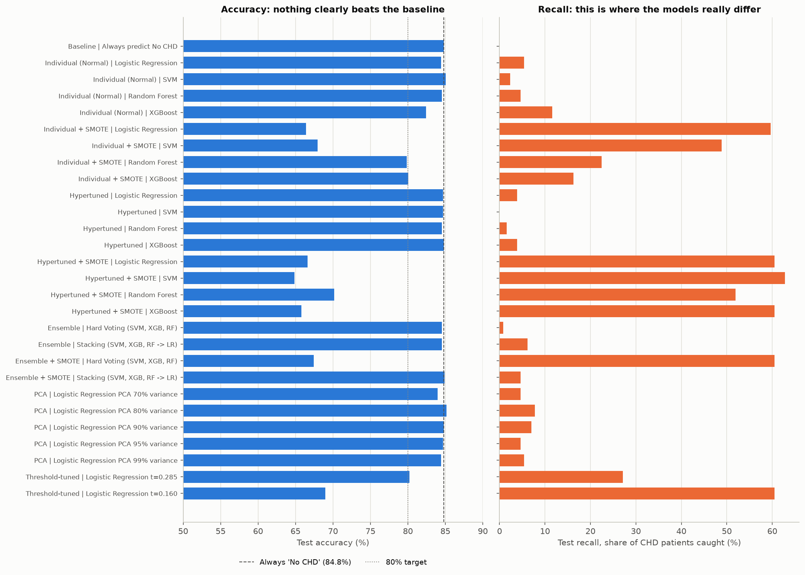
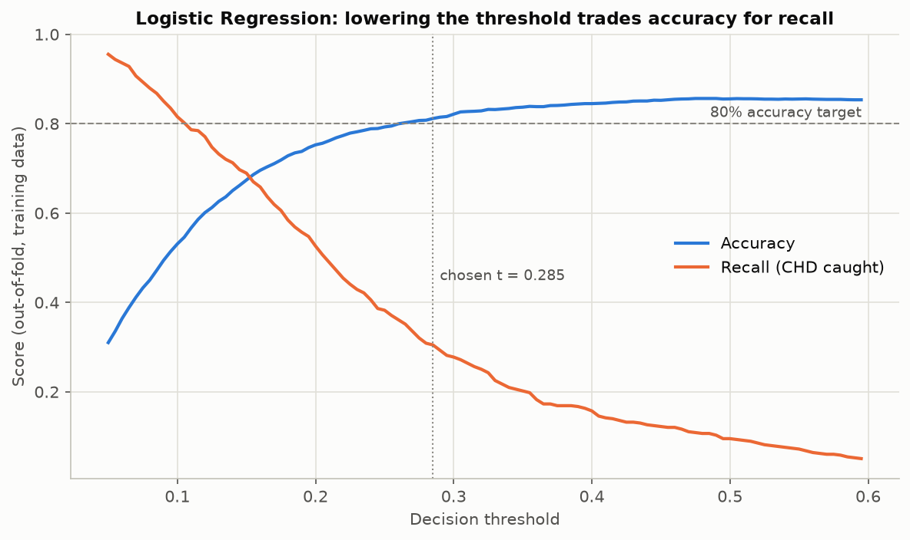

# 10-Year Coronary Heart Disease Prediction

An end-to-end machine learning pipeline on the Framingham Heart Study dataset that predicts whether a patient develops coronary heart disease (CHD) within 10 years.

## Dataset

`framingham.csv` is the Kaggle subset of the Framingham Heart Study: 4,240 patients, 15 risk factors and the target `TenYearCHD`. Only 15.2% of patients developed CHD, so a model that always predicts "no CHD" already scores 84.8% accuracy.

| Column | Meaning | Missing |
|---|---|---|
| `male` | 1 = male, 0 = female | 0 |
| `age` | Age in years (32-70) | 0 |
| `education` | 1 = some high school, 2 = high school, 3 = some college, 4 = college degree | 105 |
| `currentSmoker` | 1 = smokes | 0 |
| `cigsPerDay` | Cigarettes smoked per day | 29 |
| `BPMeds` | 1 = on blood pressure medication | 53 |
| `prevalentStroke` | 1 = previous stroke | 0 |
| `prevalentHyp` | 1 = hypertensive | 0 |
| `diabetes` | 1 = diabetic | 0 |
| `totChol` | Total cholesterol (mg/dL) | 50 |
| `sysBP` | Systolic blood pressure (mmHg) | 0 |
| `diaBP` | Diastolic blood pressure (mmHg) | 0 |
| `BMI` | Body mass index (kg/m²) | 19 |
| `heartRate` | Resting heart rate (beats per minute) | 1 |
| `glucose` | Glucose level (mg/dL) | 388 |
| `TenYearCHD` | Target: 1 = developed CHD within 10 years | 0 |

## How to run

```bash
pip install -r requirements.txt
python 07.py
```

The script takes about 5 minutes and writes all charts plus `model_comparison.csv` to `07_outputs/`.

## Pipeline

| Section | What it does |
|---|---|
| Q1 Preprocessing | Median/mode imputation, duplicate check, encoding check, stratified 80:20 split, standard scaling |
| Q2 EDA | Descriptive statistics, correlation heatmap, histograms, boxplots, count plots, scatter plots, CHD rate by risk factor |
| Q3 Feature selection | Mutual Information and RFE, SMOTE on the training set |
| Q4 Models | Logistic Regression, SVM, Random Forest, XGBoost, with and without SMOTE, plus GridSearchCV / RandomizedSearchCV tuning |
| Q5 Ensembles | Hard voting and stacking over SVM, XGBoost and Random Forest |
| Q6 PCA | Best model retrained on 70-99% of the variance |
| Q7 Comparison | Full comparison table, decision-threshold tuning and model selection |

Imputation, scaling and SMOTE are fitted inside pipelines on training data only, so no information leaks from the test set.

## Results

| Model | Test accuracy | Recall (CHD caught) |
|---|---|---|
| Always predict "no CHD" | 84.8% | 0% |
| Logistic Regression, threshold 0.5 | 84.4% | 5.4% |
| Logistic Regression, threshold 0.285 | 80.2% | 27.1% |
| Logistic Regression, threshold 0.16 (screening) | 69.0% | 60.5% |

- Accuracy plateaus at about 85% for every model, tuning and preprocessing choice, which is no better than the baseline.
- The models differ in how many CHD patients they catch, so the decision threshold is chosen from cross-validated training predictions.
- Logistic Regression was selected as the simplest model within one standard error of the best cross-validated ROC-AUC (0.73).





## Key insights

- CHD risk rises from 5% at ages 31-40 to 28% at ages 61-70.
- Patients with systolic BP above 160 mmHg have a 32% CHD rate, against 9% at or below 120.
- Fasting glucose above 126 mg/dL is linked to a 44% CHD rate.
- Smoking status alone barely matters (15.9% vs 14.5%), but more than 20 cigarettes a day reaches 21%.

## A note on 90%+ accuracy claims

Several published results on this dataset report 90-96% accuracy. Those numbers appear when the data is oversampled before the train/test split, so synthetic copies of patients end up in the test set. Reproducing that mistake here gives 95% accuracy with a Random Forest; done correctly, the same model scores about 84%.
